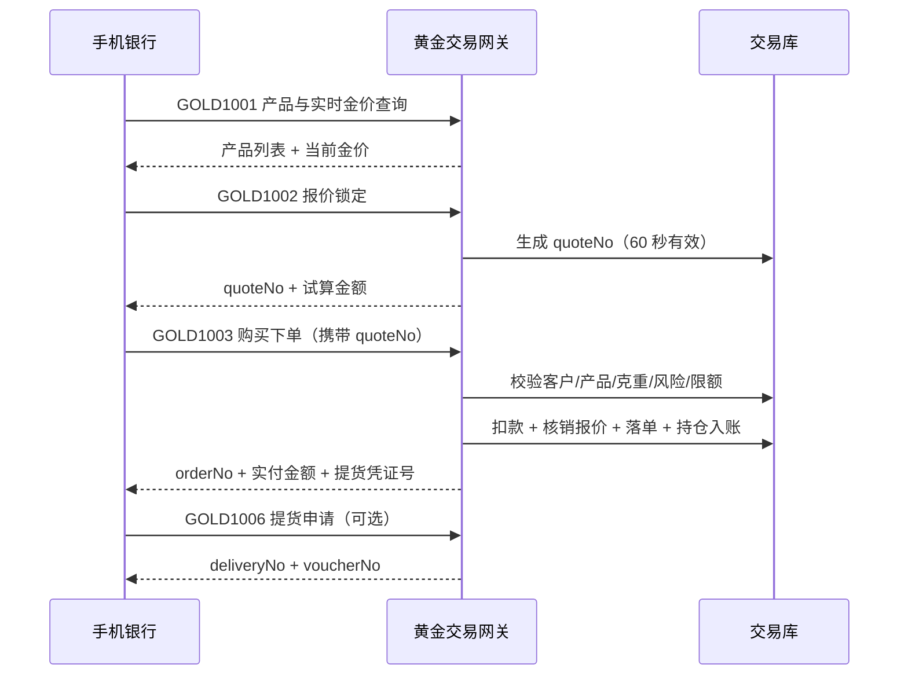

# 实物黄金购买接口设计说明

| 项目 | 内容 |
| --- | --- |
| 接口名称 | 实物黄金购买接口（Physical Gold Purchase API） |
| 接口风格 | HTTP + XML（POST，单入口按交易码路由） |
| 调用方 | 手机银行 App / 微信银行 / 网点柜台 |
| 提供方 | 黄金交易网关（Spring Boot 3.3 + Java 17） |
| 接口版本 | 1.0.0 |
| 文档版本 | v1.0 |

---

## 1. 业务概述

客户在手机银行完成「看金价 → 锁价 → 下单付款 → 持仓/提货」的完整链路。本接口覆盖实物黄金（投资金条、积存金）的购买、查询、撤销与提货申请。

**参与方**

- **手机银行（渠道）**：展示金价、收集客户指令、发起 HTTP+XML 调用。
- **黄金交易网关（本服务）**：报文校验、验签、幂等、业务编排、响应签名。
- **核心系统**：客户信息、资金账户扣款/退款（本示例以本地账户表模拟）。
- **贵金属库存/物流系统**：提货单受理、网点出库、快递发货（本示例生成提货单，出库动作走异步）。

**典型时序**



---

## 2. 通讯约定

| 项目 | 约定 |
| --- | --- |
| 请求地址 | `POST https://{host}:{port}/gold/gateway` |
| Content-Type | `application/xml;charset=UTF-8` |
| 响应 Content-Type | `application/xml;charset=UTF-8` |
| 传输协议 | HTTPS（TLS 1.2 及以上），生产环境建议双向认证 mTLS |
| 字符集 | UTF-8 |
| 超时 | 连接 3s / 读取 10s |
| 路由方式 | 单一入口，由 `header/tranCode` 区分交易 |
| 幂等键 | `header/reqSerialNo`（渠道侧生成，全局唯一，≤32 位） |
| 重试策略 | 查询类可直接重试；交易类**必须**使用同一 `reqSerialNo` 重试，服务端保证只成交一次 |
| 性能目标 | 查询类 P99 < 300ms，下单 P99 < 1s |

> 统一入口的好处：新增交易码不需要渠道侧改 URL、改防火墙策略，只需增加 body 字段与交易码。

---

## 3. 报文结构

### 3.1 请求报文

```xml
<?xml version="1.0" encoding="UTF-8"?>
<request>
  <header>
    <tranCode>GOLD1003</tranCode>
    <version>1.0.0</version>
    <channel>MOBILE_BANK</channel>
    <bankCode>ICBC</bankCode>
    <reqSerialNo>MB20261101000103</reqSerialNo>
    <reqTime>2026-11-01 16:34:01</reqTime>
    <signType>RSA2</signType>
    <sign>Base64 签名串</sign>
  </header>
  <body>
    <customerNo>C1000001</customerNo>
    <accountNo>6222021234567890</accountNo>
    <productCode>AU9999-10G</productCode>
    <quoteNo>Q202611011633588084403</quoteNo>
    <weight>10</weight>
    <deliveryMode>DEPOSIT</deliveryMode>
  </body>
</request>
```

**header 公共字段**

| 字段 | 类型 | 必填 | 说明 |
| --- | --- | --- | --- |
| tranCode | String(16) | Y | 交易码，见第 6 节 |
| version | String(8) | Y | 接口版本，当前 `1.0.0` |
| channel | String(16) | Y | 渠道号：`MOBILE_BANK` / `WECHAT_BANK` / `COUNTER` |
| bankCode | String(16) | Y | 机构号 |
| reqSerialNo | String(32) | Y | 请求流水号，渠道侧唯一，幂等键 |
| reqTime | String(19) | Y | 请求时间 `yyyy-MM-dd HH:mm:ss`，与服务器时间偏差不得超过 300 秒 |
| signType | String(8) | Y | 签名算法，固定 `RSA2`（SHA256withRSA） |
| sign | String(1024) | Y | 签名值，Base64；规则见第 5 节 |

### 3.2 响应报文

```xml
<?xml version="1.0" encoding="UTF-8"?>
<response>
  <header>
    <tranCode>GOLD1003</tranCode>
    <respCode>000000</respCode>
    <respMsg>交易成功</respMsg>
    <reqSerialNo>MB20261101000103</reqSerialNo>
    <respSerialNo>R202611011634016064806</respSerialNo>
    <respTime>2026-11-01 16:34:01</respTime>
    <sign>Base64 签名串</sign>
  </header>
  <body>
    <orderNo>AU202611011634015940451</orderNo>
    <status>SUCCESS</status>
    <!-- 业务字段 -->
  </body>
</response>
```

| 字段 | 类型 | 说明 |
| --- | --- | --- |
| respCode | String(6) | `000000` 成功，其余见第 8 节错误码 |
| respMsg | String(256) | 响应描述，失败时可直接展示给柜员，客户端可再做友好化 |
| reqSerialNo | String(32) | 原样回传请求流水号，便于渠道对账 |
| respSerialNo | String(32) | 本服务响应流水号，问题排查凭据 |
| respTime | String(19) | 响应时间 |
| sign | String(1024) | 本行私钥签名，手机银行用本行公钥验签 |

> **注意**：交易失败时 `body` 节点整体省略，客户端必须先判 `respCode`，再取 `body` 字段。

### 3.3 字段格式规范

| 类型 | 规范 |
| --- | --- |
| 金额 | 以「元」为单位，字符串形式，最多 2 位小数，如 `6305.00` |
| 克重 | 字符串形式，最多 4 位小数，如 `10.0000` |
| 日期时间 | `yyyy-MM-dd HH:mm:ss`；日期 `yyyy-MM-dd` |
| 枚举 | 大写英文常量（`DEPOSIT`/`PICKUP`/`EXPRESS` 等） |
| 空值 | 值为空时字段可整体省略，服务端按空处理 |
| 数字类型 | 服务端全部使用 `BigDecimal` 计算，禁止浮点运算 |

---

## 4. 安全设计

### 4.1 报文签名（RSA2）

**待签名串规则**（与报文缩进、字段顺序无关）：

1. 取报文中全部**叶子节点**，按「节点路径 = 节点文本」组成一行；
2. 节点路径以 `.` 连接，例如 `body.productCode`；
3. 同名兄弟节点追加 `[n]` 序号，例如 `products.product[1].code`；
4. 按路径 **ASCII 升序**排序，用 `&` 连接；
5. 签名节点 `sign` 自身不参与签名；节点文本两端空白去除。

**示例**

报文（节选）：

```xml
<request>
  <header>
    <tranCode>GOLD1003</tranCode>
    <reqSerialNo>MB20261101000103</reqSerialNo>
    <sign>IGNORED</sign>
  </header>
  <body>
    <customerNo>C1000001</customerNo>
    <weight>10</weight>
  </body>
</request>
```

待签名串：

```
body.customerNo=C1000001&body.weight=10&header.reqSerialNo=MB20261101000103&header.tranCode=GOLD1003
```

签名：`Base64(SHA256withRSA(待签名串, 渠道私钥))`。

**验签步骤（服务端）**：解析报文 → 按上述规则重组待签名串 → 用渠道公钥验签 → 不通过返回 `100004`。

**响应签名**：服务端组装完 header + body 后，用本行私钥对同一规则签名，写入 `header/sign`。渠道侧用本行公钥验签。

实现代码：`com.bank.gold.common.SignUtils`、`com.bank.gold.protocol.SignService`。

### 4.2 防重放

| 手段 | 说明 |
| --- | --- |
| 时间戳 | `reqTime` 与服务器时间偏差 > 300 秒直接拒绝（`100005`） |
| 流水号唯一 | `reqSerialNo` 在 `gold_tran_log` 上建唯一索引，重复请求走幂等分支 |
| 签名 | 篡改任一字段签名即失效 |

### 4.3 幂等规则

| 场景 | 服务端行为 | 渠道感知 |
| --- | --- | --- |
| 首次请求 | 落流水（PROCESSING）→ 正常处理 | 正常结果 |
| 重复请求，首次已成功 | 直接返回首次响应报文（含原 orderNo） | 与首次完全一致，不会重复扣款 |
| 重复请求，首次处理中 | 返回 `100007` | 稍后查询订单 |
| 重复请求，首次已失败 | 重置为处理中并重新处理 | 允许重试 |

实现：`TranLogService` + `TranLogWriter`（流水使用独立事务 `REQUIRES_NEW`，业务回滚不影响流水留痕）。

### 4.4 传输与数据安全

- 全链路 HTTPS，生产建议 mTLS（渠道证书 + 行方证书双向校验）。
- 卡号、身份证等敏感字段**不落日志**；响应中卡号仅回传必要场景，建议做掩码（`6222********7890`）。
- 密钥由密钥管理系统（KMS/HSM）下发，支持双密钥并行与定期轮换；配置项 `gold.sign.public-key` / `gold.sign.private-key` 仅为示例。
- XML 解析显式关闭 DTD 与外部实体（防 XXE）：见 `XmlUtils#factory()`。

---

## 5. 交易码清单

| 交易码 | 名称 | 是否幂等 | 说明 |
| --- | --- | --- | --- |
| GOLD1001 | 黄金产品与实时金价查询 | 是 | 返回在售产品、当前金价、加工费、克重规则 |
| GOLD1002 | 报价锁定 | 是 | 生成 quoteNo，锁价 60 秒，可顺带试算金额 |
| GOLD1003 | 实物黄金购买下单 | 是 | 核心交易：校验 + 扣款 + 落单 + 持仓入账 |
| GOLD1004 | 购买订单查询 | 是 | 按订单号精确查询，或按客户 + 日期区间查询 |
| GOLD1005 | 购买订单撤销 | 是 | 当日、未提货订单可撤，资金原路退回 |
| GOLD1006 | 提货申请 | 是 | 账户存金转网点自提/快递配送 |
| GOLD1007 | 黄金持仓查询 | 是 | 持仓克重、可用/冻结、市值、浮盈 |

---

## 6. 接口详细定义

### 6.1 GOLD1001 黄金产品与实时金价查询

**请求 body**

| 字段 | 类型 | 必填 | 说明 |
| --- | --- | --- | --- |
| productCode | String(32) | N | 产品代码，为空返回全部在售产品 |
| brand | String(64) | N | 品牌筛选 |

**响应 body**

| 字段 | 类型 | 说明 |
| --- | --- | --- |
| queryTime | String(19) | 报价时间 |
| totalCount | Integer | 产品数量 |
| products/product | 数组 | 产品明细 |
| └ productCode | String(32) | 产品代码 |
| └ productName | String(128) | 产品名称 |
| └ brand | String(64) | 品牌 |
| └ spec | String(64) | 规格，如「10克/根」 |
| └ unit | String(8) | 计价单位，固定「克」 |
| └ pricePerGram | Decimal | 当前金价（元/克） |
| └ feePerGram | Decimal | 加工费（元/克） |
| └ minWeight | Decimal | 最小购买克重 |
| └ maxWeightPerOrder | Decimal | 单笔最大克重 |
| └ stepWeight | Decimal | 克重步长（如 10 克递增） |
| └ riskLevel | String(8) | 产品风险等级 R1~R5 |
| └ status | String(16) | `ON_SALE` 在售 |

**请求示例**

```xml
<?xml version="1.0" encoding="UTF-8"?>
<request>
  <header>
    <tranCode>GOLD1001</tranCode>
    <version>1.0.0</version>
    <channel>MOBILE_BANK</channel>
    <bankCode>ICBC</bankCode>
    <reqSerialNo>MB20261101000101</reqSerialNo>
    <reqTime>2026-11-01 16:33:57</reqTime>
    <signType>RSA2</signType>
    <sign>Base64 签名串</sign>
  </header>
  <body>
    <productCode>AU9999-10G</productCode>
  </body>
</request>
```

**响应示例**（实测报文）

```xml
<?xml version="1.0" encoding="UTF-8"?>
<response>
  <header>
    <tranCode>GOLD1001</tranCode>
    <respCode>000000</respCode>
    <respMsg>交易成功</respMsg>
    <reqSerialNo>MB20261101000101</reqSerialNo>
    <respSerialNo>R202611011633573189333</respSerialNo>
    <respTime>2026-11-01 16:33:57</respTime>
    <sign>Base64 签名串</sign>
  </header>
  <body>
    <queryTime>2026-11-01 16:33:57</queryTime>
    <totalCount>1</totalCount>
    <products>
      <product>
        <productCode>AU9999-10G</productCode>
        <productName>如意金条 10克</productName>
        <brand>工银金</brand>
        <spec>10克/根</spec>
        <unit>克</unit>
        <pricePerGram>618.50</pricePerGram>
        <feePerGram>12.00</feePerGram>
        <minWeight>10.0000</minWeight>
        <maxWeightPerOrder>100.0000</maxWeightPerOrder>
        <stepWeight>10.0000</stepWeight>
        <riskLevel>R2</riskLevel>
        <status>ON_SALE</status>
      </product>
    </products>
  </body>
</response>
```

### 6.2 GOLD1002 报价锁定

金价实时波动，下单前必须锁价，避免「展示价 ≠ 成交价」的客诉。

**请求 body**

| 字段 | 类型 | 必填 | 说明 |
| --- | --- | --- | --- |
| customerNo | String(32) | Y | 客户号 |
| productCode | String(32) | Y | 产品代码 |
| weight | Decimal | N | 拟购买克重，传入则返回试算金额 |

**响应 body**

| 字段 | 类型 | 说明 |
| --- | --- | --- |
| quoteNo | String(40) | 报价单号，下单时回传 |
| customerNo | String(32) | 客户号 |
| productCode | String(32) | 产品代码 |
| productName | String(128) | 产品名称 |
| pricePerGram | Decimal | 锁定金价（元/克） |
| feePerGram | Decimal | 加工费（元/克） |
| weight | Decimal | 试算克重 |
| goldAmount | Decimal | 金价金额 |
| feeAmount | Decimal | 加工费金额 |
| totalAmount | Decimal | 合计应付 |
| quoteTime | String(19) | 锁价时间 |
| expireTime | String(19) | 失效时间 |
| expireSeconds | Integer | 剩余有效秒数（默认 60） |

**响应示例**

```xml
<?xml version="1.0" encoding="UTF-8"?>
<response>
  <header>
    <tranCode>GOLD1002</tranCode>
    <respCode>000000</respCode>
    <respMsg>交易成功</respMsg>
    <reqSerialNo>MB20261101000102</reqSerialNo>
    <respSerialNo>R202611011633588151260</respSerialNo>
    <respTime>2026-11-01 16:33:58</respTime>
    <sign>Base64 签名串</sign>
  </header>
  <body>
    <quoteNo>Q202611011633588084403</quoteNo>
    <customerNo>C1000001</customerNo>
    <productCode>AU9999-10G</productCode>
    <productName>如意金条 10克</productName>
    <pricePerGram>618.50</pricePerGram>
    <feePerGram>12.00</feePerGram>
    <weight>10</weight>
    <goldAmount>6185.00</goldAmount>
    <feeAmount>120.00</feeAmount>
    <totalAmount>6305.00</totalAmount>
    <quoteTime>2026-11-01 16:33:58</quoteTime>
    <expireTime>2026-11-01 16:34:58</expireTime>
    <expireSeconds>60</expireSeconds>
  </body>
</response>
```

### 6.3 GOLD1003 实物黄金购买下单

**请求 body**

| 字段 | 类型 | 必填 | 说明 |
| --- | --- | --- | --- |
| customerNo | String(32) | Y | 客户号 |
| accountNo | String(32) | Y | 付款账号（借记卡） |
| productCode | String(32) | Y | 产品代码 |
| quoteNo | String(40) | Y | 报价单号，须为未使用且未过期的报价 |
| weight | Decimal | Y | 购买克重，最多 4 位小数，需满足步长 |
| deliveryMode | String(16) | Y | `DEPOSIT` 账户存金 / `PICKUP` 网点自提 / `EXPRESS` 快递配送 |
| branchNo | String(32) | 条件 | `PICKUP` 时必填，提货网点号 |
| receiverName | String(64) | 条件 | `EXPRESS` 时必填 |
| receiverPhone | String(20) | 条件 | `EXPRESS` 时必填 |
| receiverAddress | String(200) | 条件 | `EXPRESS` 时必填 |
| remark | String(200) | N | 备注 |

**响应 body**

| 字段 | 类型 | 说明 |
| --- | --- | --- |
| orderNo | String(40) | 订单号 |
| status | String(16) | `SUCCESS` |
| customerNo | String(32) | 客户号 |
| productCode / productName | String | 产品信息 |
| weight | Decimal | 成交克重 |
| pricePerGram | Decimal | 成交金价 |
| goldAmount | Decimal | 金价金额 |
| feeAmount | Decimal | 加工费 |
| totalAmount | Decimal | 实付金额 |
| deliveryMode | String(16) | 提货方式 |
| voucherNo | String(40) | 提货凭证号（`DEPOSIT` 时为空） |
| deliveryNo | String(40) | 提货单号（`DEPOSIT` 时为空） |
| accountNo | String(32) | 付款账号 |
| balanceAfter | Decimal | 扣款后可用余额 |
| holdingWeight | Decimal | 买入后该产品累计持仓克重 |
| orderTime | String(19) | 下单时间 |

**请求示例**

```xml
<?xml version="1.0" encoding="UTF-8"?>
<request>
  <header>
    <tranCode>GOLD1003</tranCode>
    <version>1.0.0</version>
    <channel>MOBILE_BANK</channel>
    <bankCode>ICBC</bankCode>
    <reqSerialNo>MB20261101000103</reqSerialNo>
    <reqTime>2026-11-01 16:34:01</reqTime>
    <signType>RSA2</signType>
    <sign>Base64 签名串</sign>
  </header>
  <body>
    <customerNo>C1000001</customerNo>
    <accountNo>6222021234567890</accountNo>
    <productCode>AU9999-10G</productCode>
    <quoteNo>Q202611011633588084403</quoteNo>
    <weight>10</weight>
    <deliveryMode>DEPOSIT</deliveryMode>
    <remark>手机银行购买</remark>
  </body>
</request>
```

**响应示例**（实测报文）

```xml
<?xml version="1.0" encoding="UTF-8"?>
<response>
  <header>
    <tranCode>GOLD1003</tranCode>
    <respCode>000000</respCode>
    <respMsg>交易成功</respMsg>
    <reqSerialNo>MB20261101000103</reqSerialNo>
    <respSerialNo>R202611011634016064806</respSerialNo>
    <respTime>2026-11-01 16:34:01</respTime>
    <sign>Base64 签名串</sign>
  </header>
  <body>
    <orderNo>AU202611011634015940451</orderNo>
    <status>SUCCESS</status>
    <customerNo>C1000001</customerNo>
    <productCode>AU9999-10G</productCode>
    <productName>如意金条 10克</productName>
    <weight>10</weight>
    <pricePerGram>618.50</pricePerGram>
    <goldAmount>6185.00</goldAmount>
    <feeAmount>120.00</feeAmount>
    <totalAmount>6305.00</totalAmount>
    <deliveryMode>DEPOSIT</deliveryMode>
    <accountNo>6222021234567890</accountNo>
    <balanceAfter>193695.00</balanceAfter>
    <holdingWeight>10</holdingWeight>
    <orderTime>2026-11-01 16:34:01</orderTime>
  </body>
</response>
```

### 6.4 GOLD1004 购买订单查询

**请求 body**

| 字段 | 类型 | 必填 | 说明 |
| --- | --- | --- | --- |
| customerNo | String(32) | Y | 客户号 |
| orderNo | String(40) | N | 订单号；填写时精确查询单笔 |
| beginDate | String(10) | N | 起始日期 `yyyy-MM-dd`，与 endDate 成对出现 |
| endDate | String(10) | N | 截止日期 `yyyy-MM-dd` |

> 未传 orderNo 与日期区间时，返回该客户最近 20 笔订单（按时间倒序）。

**响应 body**：`totalCount` + `orders/order[]`（orderNo、productCode、productName、weight、pricePerGram、goldAmount、feeAmount、totalAmount、deliveryMode、status、voucherNo、orderTime）

**响应示例**

```xml
<?xml version="1.0" encoding="UTF-8"?>
<response>
  <header>
    <tranCode>GOLD1004</tranCode>
    <respCode>000000</respCode>
    <respMsg>交易成功</respMsg>
    <reqSerialNo>MB20261101000104</reqSerialNo>
    <respSerialNo>R202611011634040752166</respSerialNo>
    <respTime>2026-11-01 16:34:04</respTime>
    <sign>Base64 签名串</sign>
  </header>
  <body>
    <totalCount>1</totalCount>
    <orders>
      <order>
        <orderNo>AU202611011634015940451</orderNo>
        <productCode>AU9999-10G</productCode>
        <productName>如意金条 10克</productName>
        <weight>10.0000</weight>
        <pricePerGram>618.50</pricePerGram>
        <goldAmount>6185.00</goldAmount>
        <feeAmount>120.00</feeAmount>
        <totalAmount>6305.00</totalAmount>
        <deliveryMode>DEPOSIT</deliveryMode>
        <status>SUCCESS</status>
        <orderTime>2026-11-01 16:34:01</orderTime>
      </order>
    </orders>
  </body>
</response>
```

### 6.5 GOLD1005 购买订单撤销

**请求 body**

| 字段 | 类型 | 必填 | 说明 |
| --- | --- | --- | --- |
| customerNo | String(32) | Y | 客户号 |
| orderNo | String(40) | Y | 订单号 |
| reason | String(200) | N | 撤销原因 |

**可撤销条件**：订单状态 `SUCCESS` + 下单日期为当日 + 提货单状态为 `APPLIED`（未出库）。

**响应 body**：orderNo、status(`CANCELLED`)、refundAmount、accountNo、balanceAfter、holdingWeight、cancelTime

**响应示例**

```xml
<?xml version="1.0" encoding="UTF-8"?>
<response>
  <header>
    <tranCode>GOLD1005</tranCode>
    <respCode>000000</respCode>
    <respMsg>交易成功</respMsg>
    <reqSerialNo>MB20261101000107</reqSerialNo>
    <respSerialNo>R202611011634093266887</respSerialNo>
    <respTime>2026-11-01 16:34:09</respTime>
    <sign>Base64 签名串</sign>
  </header>
  <body>
    <orderNo>AU202611011634015940451</orderNo>
    <status>CANCELLED</status>
    <refundAmount>6305.00</refundAmount>
    <accountNo>6222021234567890</accountNo>
    <balanceAfter>200000.00</balanceAfter>
    <holdingWeight>0.0000</holdingWeight>
    <cancelTime>2026-11-01 16:34:09</cancelTime>
  </body>
</response>
```

### 6.6 GOLD1006 提货申请

针对 `deliveryMode=DEPOSIT`（账户存金）的订单，客户后续申请提取实物。受理后可用克重转冻结克重，生成提货凭证号。

**请求 body**

| 字段 | 类型 | 必填 | 说明 |
| --- | --- | --- | --- |
| customerNo | String(32) | Y | 客户号 |
| orderNo | String(40) | Y | 订单号 |
| deliveryMode | String(16) | Y | `PICKUP` 网点自提 / `EXPRESS` 快递配送 |
| branchNo | String(32) | 条件 | `PICKUP` 必填 |
| branchName | String(128) | 条件 | `PICKUP` 必填 |
| receiverName | String(64) | 条件 | `EXPRESS` 必填 |
| receiverPhone | String(20) | 条件 | `EXPRESS` 必填 |
| receiverAddress | String(200) | 条件 | `EXPRESS` 必填 |

**响应 body**：deliveryNo、orderNo、voucherNo、deliveryMode、weight、status(`APPLIED`)、branchNo、branchName、expectTime

**响应示例**

```xml
<?xml version="1.0" encoding="UTF-8"?>
<response>
  <header>
    <tranCode>GOLD1006</tranCode>
    <respCode>000000</respCode>
    <respMsg>交易成功</respMsg>
    <reqSerialNo>MB20261101000106</reqSerialNo>
    <respSerialNo>R202611011634072876360</respSerialNo>
    <respTime>2026-11-01 16:34:07</respTime>
    <sign>Base64 签名串</sign>
  </header>
  <body>
    <deliveryNo>D202611011634072812349</deliveryNo>
    <orderNo>AU202611011634015940451</orderNo>
    <voucherNo>V202611011634072811130</voucherNo>
    <deliveryMode>PICKUP</deliveryMode>
    <weight>10.0000</weight>
    <status>APPLIED</status>
    <branchNo>01001</branchNo>
    <branchName>北京西单支行</branchName>
    <expectTime>2026-11-02 16:34:07</expectTime>
  </body>
</response>
```

### 6.7 GOLD1007 黄金持仓查询

**请求 body**：`customerNo`（必填）

**响应 body**

| 字段 | 类型 | 说明 |
| --- | --- | --- |
| customerNo | String(32) | 客户号 |
| totalWeight | Decimal | 持仓总克重 |
| totalCostAmount | Decimal | 持仓总成本（含加工费） |
| totalMarketValue | Decimal | 按当前金价计算的市值 |
| totalProfit | Decimal | 浮动盈亏 |
| holdings/holding | 数组 | 明细：productCode、productName、totalWeight、availableWeight（可提）、frozenWeight（已申请提货）、costAmount、avgPrice、marketValue、profit |

**响应示例**

```xml
<?xml version="1.0" encoding="UTF-8"?>
<response>
  <header>
    <tranCode>GOLD1007</tranCode>
    <respCode>000000</respCode>
    <respMsg>交易成功</respMsg>
    <reqSerialNo>MB20261101000105</reqSerialNo>
    <respSerialNo>R202611011634055834842</respSerialNo>
    <respTime>2026-11-01 16:34:05</respTime>
    <sign>Base64 签名串</sign>
  </header>
  <body>
    <customerNo>C1000001</customerNo>
    <totalWeight>10.0000</totalWeight>
    <totalCostAmount>6305.00</totalCostAmount>
    <totalMarketValue>6185.00</totalMarketValue>
    <totalProfit>-120.00</totalProfit>
    <holdings>
      <holding>
        <productCode>AU9999-10G</productCode>
        <productName>如意金条 10克</productName>
        <totalWeight>10.0000</totalWeight>
        <availableWeight>10.0000</availableWeight>
        <frozenWeight>0.0000</frozenWeight>
        <costAmount>6305.00</costAmount>
        <avgPrice>630.50</avgPrice>
        <marketValue>6185.00</marketValue>
        <profit>-120.00</profit>
      </holding>
    </holdings>
  </body>
</response>
```

---

## 7. 错误码

| respCode | 含义 | 渠道侧建议处理 |
| --- | --- | --- |
| 000000 | 交易成功 | — |
| 100001 | 报文格式错误 | 检查 XML 结构、Content-Type |
| 100002 | 必填字段缺失 | 按 respMsg 提示补字段 |
| 100003 | 字段格式错误 | 检查日期/金额/枚举格式 |
| 100004 | 签名验证失败 | 检查签名规则与密钥 |
| 100005 | 报文时间戳超范围 | 校准渠道服务器时间（NTP） |
| 100006 | 不支持的交易码 | 检查 tranCode |
| 100007 | 交易正在处理中 | 稍后用 GOLD1004 查询结果 |
| 200001 | 客户不存在或状态异常 | 提示客户联系客服 |
| 200002 | 产品不存在或已下架 | 刷新产品列表 |
| 200003 | 报价已失效 | 重新 GOLD1002 锁价 |
| 200004 | 克重不符合产品规格 | 按 minWeight/stepWeight 提示 |
| 200005 | 客户风险等级不足 | 引导做风险测评 |
| 200006 | 账户余额不足 | 提示更换账户 |
| 200007 | 超过单笔限额 | 拆分下单 |
| 200008 | 超过单日累计限额 | 次日再买 |
| 200009 | 订单不存在 | 检查订单号/客户号 |
| 200010 | 订单状态不允许该操作 | 提示不可撤销/重复提货 |
| 200011 | 提货信息不完整 | 补网点或收件信息 |
| 200012 | 该订单已申请提货 | 查询提货单状态 |
| 200013 | 可提货克重不足 | 检查可用克重 |
| 999999 | 系统繁忙 | 用同一 reqSerialNo 重试 |

---

## 8. 业务规则

**克重规格**
- 精度最多 4 位小数；
- 需满足 `minWeight ≤ weight ≤ maxWeightPerOrder`；
- 需为 `stepWeight` 的整数倍（金条 10 克起、10 克递增；积存金 1 克起、0.01 克递增）。

**金额计算**
```
金价金额 = 克重 × 锁定金价     （保留 2 位，四舍五入）
加工费   = 克重 × 加工费单价   （保留 2 位，四舍五入）
实付金额 = 金价金额 + 加工费
```
示例：10 克 × 618.50 + 10 克 × 12.00 = 6185.00 + 120.00 = **6305.00 元**

**限额**
- 单笔金额上限：`gold.limit.single-amount-limit`（默认 200,000 元）
- 单日累计上限：`gold.limit.daily-amount-limit`（默认 500,000 元），按客户当日 `SUCCESS` 订单累计。

**风险等级**
- 客户风险等级须 ≥ 产品风险等级（R1~R5 数值比较），否则拒绝（`200005`）。

**报价有效期**
- 默认 60 秒（`gold.quote.ttl-seconds`），过期下单返回 `200003`，客户端需重新锁价。
- 一张报价单只能成交一次（成交后置 `USED`）。

**持仓口径**
| 提货方式 | 下单后 | 提货完成后 |
| --- | --- | --- |
| DEPOSIT 账户存金 | 总克重 +、可用克重 + | — |
| PICKUP / EXPRESS | 总克重 +、冻结克重 + | 总克重 −、冻结克重 − |

**撤销规则**
- 仅当日订单、提货单未出库（`APPLIED`）可撤；
- 撤销后资金原路退回，持仓克重与成本同步回退，提货单置 `CANCELLED`。

---

## 9. 数据模型

| 表 | 说明 | 关键索引 |
| --- | --- | --- |
| `gold_customer` | 客户（核心同步，只读） | `customer_no` 唯一 |
| `gold_account` | 资金账户（演示用） | `account_no` 唯一 |
| `gold_product` | 黄金产品与实时金价 | `product_code` 唯一 |
| `gold_quote` | 报价单（锁价凭证） | `quote_no` 唯一 |
| `gold_order` | 购买订单 | `order_no` 唯一、`(customer_no, order_time)` |
| `gold_holding` | 持仓 | `(customer_no, product_code)` 唯一 |
| `gold_delivery` | 提货单 | `delivery_no` 唯一、`order_no` |
| `gold_tran_log` | 交易流水（幂等 + 审计） | `req_serial_no` **唯一** |

MySQL 建表脚本见 `docs/schema-mysql.sql`。

---

## 10. 生产化建议

1. **并发控制**：账户扣款与持仓变更使用悲观锁（`SELECT ... FOR UPDATE`），锁顺序固定为「账户 → 持仓」，避免死锁。
2. **限额与风控**：单日限额建议改为 Redis 原子计数 + 日终对账兜底；大额交易接入反欺诈系统。
3. **异步化**：提货出库、物流下单、账务过账改为 MQ 异步，接口只保证「受理成功」，用查询接口跟踪状态。
4. **对账**：日终以 `gold_tran_log` 与核心账务流水、库存系统逐笔核对；差异自动挂账并告警。
5. **监控指标**：各交易码成功率/耗时、验签失败率、报价过期率、余额不足占比、幂等命中率。
6. **限流熔断**：网关按渠道 + 交易码限流；下游核心系统异常时快速失败并返回 `999999`。
7. **密钥管理**：密钥入 KMS/HSM，支持双密钥并行与灰度轮换；`sign.enabled=false` 只允许在本地联调使用。
8. **日志规范**：`reqSerialNo` / `respSerialNo` / `orderNo` 全程透传；卡号、身份证、手机号脱敏。
